

  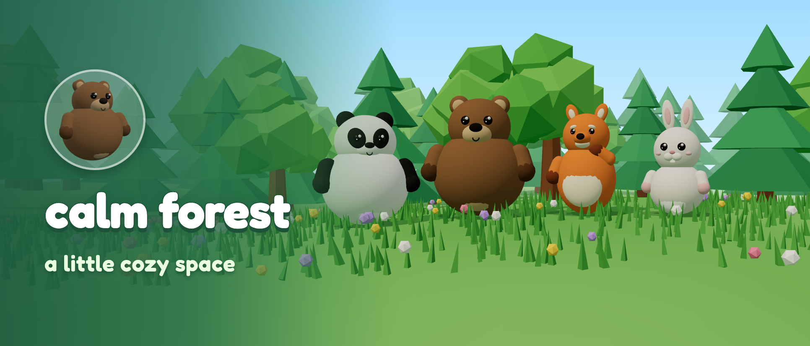

   
  <b><big>고요한 숲 · calm forest</big></b> 
  시든 세계수를 다시 피우는, 작고 포근한 숲 마을

  

  
  &nbsp;
  
  &nbsp;
  

토스 앱에서는 <b>고요한 숲</b>을 검색하세요 · PC 브라우저 · 스마트폰 · 아이폰 · 안드로이드

 

## 📜 이야기

> *세계수 아래, 사람과 동물은 함께 살았어요.* 
> *그런데 세계수가 힘을 잃자, 마을도 기운을 잃었어요.*

텅 빈 숲 마을에 동물 친구 하나가 도착합니다. 여우 · 강아지 · 토끼 · 고양이 · 곰 · 판다 · 병아리 중 하나가 바로 당신이에요.

나무를 베고, 밭을 갈고, 집을 짓다 보면 떠났던 이웃이 한 명씩 돌아옵니다. 상인이 좌판을 펴고, 목수가 망치를 들고, 다리 건너 섬에서는 큐레이터 할아버지가 세계수를 지키는 법을 알려 줘요. 세계수의 가지가 하나 살아날 때마다 마을의 한 구석이 다시 깨어납니다.

서두를 필요는 없어요. 하루는 8분, 날씨는 날마다 바뀌고, 계절은 천천히 돌아갑니다.

 

## 🌳 숲에서의 하루

<table>
  <tr>
    <td width="50%">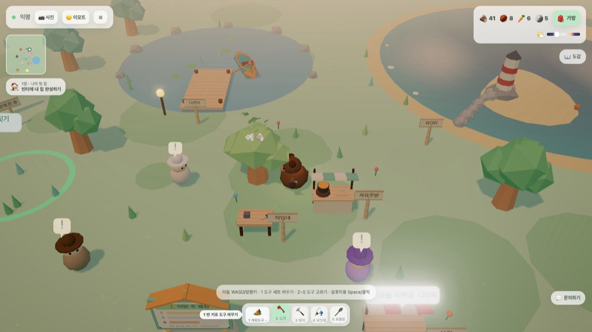 <b>🪓 나무 베기</b> 나무 옆에 서면 도끼를 저절로 들어요. 세 번 휘두르면 쿵, 목재가 쌓여요.</td>
    <td width="50%">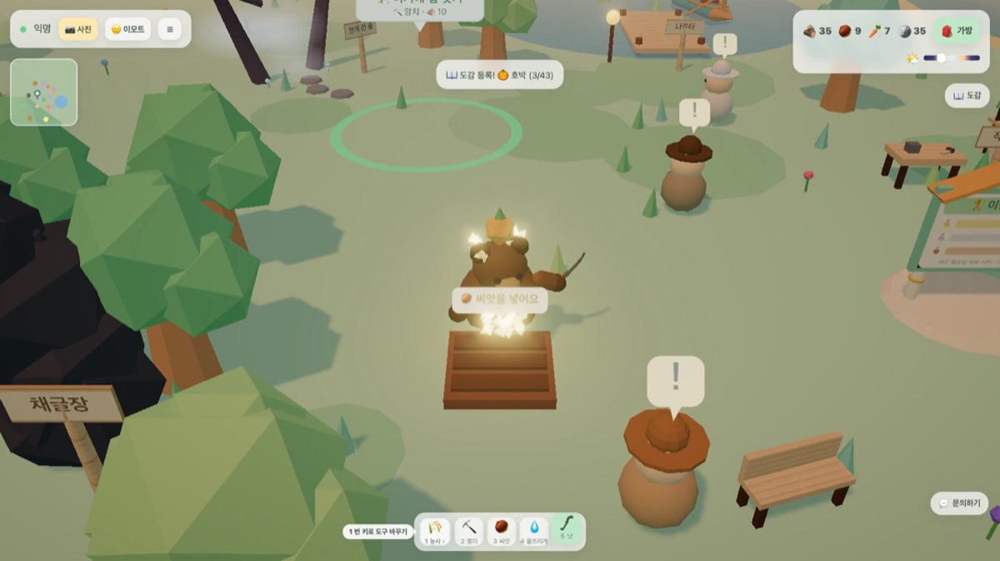 <b>🌾 밭 가꾸기</b> 갈고, 심고, 물 주고, 거둬요. 비 오는 날엔 밭이 저절로 자라요.</td>
  </tr>
  <tr>
    <td>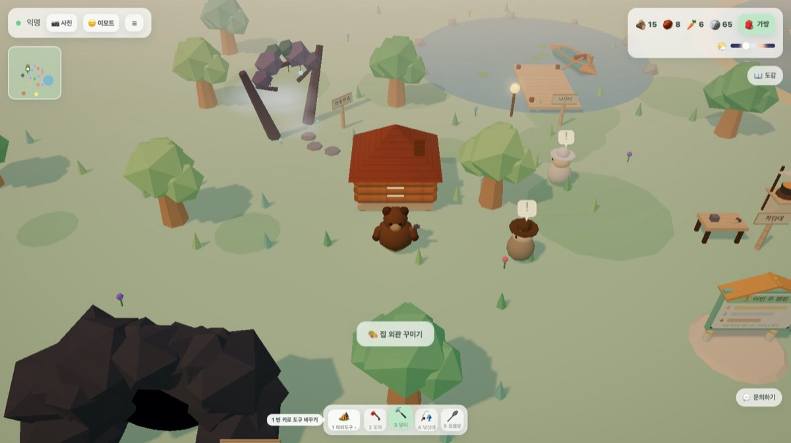 <b>🏠 내 집 짓기</b> 데크부터 지붕까지 망치로 올리고, 안을 가구로 채워요.</td>
    <td>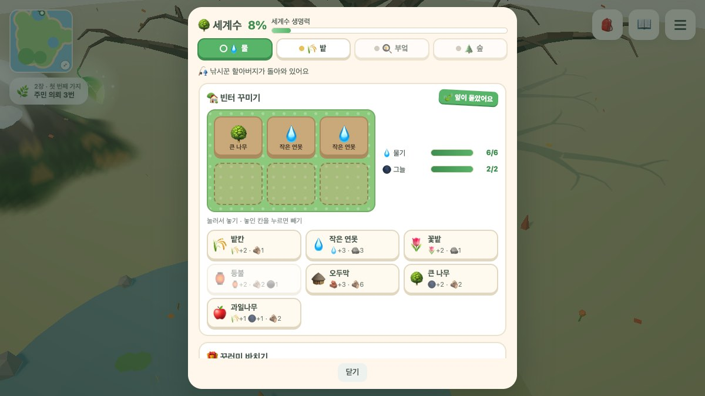 <b>🌳 세계수 되살리기</b> 가지마다 빈터를 꾸미면 주민과 장소가 하나씩 돌아와요. 이 게임의 큰 목표예요.</td>
  </tr>
  <tr>
    <td>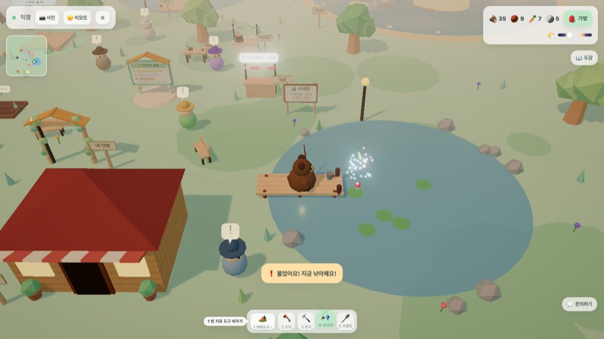 <b>🎣 호수 낚시</b> 찌가 쏙 들어가는 순간을 기다려요. 무지개 물고기는 비 오는 날에만 나와요.</td>
    <td>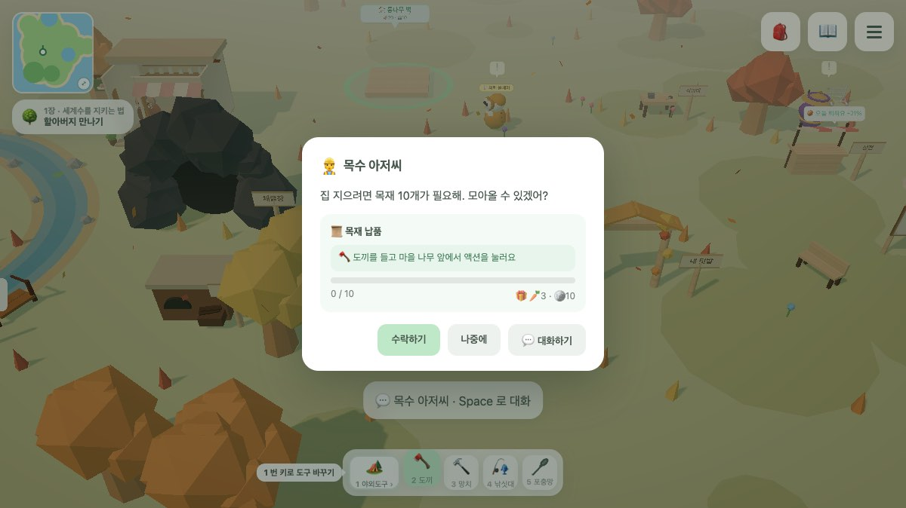 <b>🦉 이웃과 의뢰</b> 올빼미가 매일 다섯 건의 의뢰를 가져와요. 선물을 주면 이웃과 더 가까워져요.</td>
  </tr>
</table>

 

## 🎮 미니게임

마을이 살아날수록 갈 수 있는 곳이 늘어납니다. 어느 미니게임도 실패해서 잃는 건 없어요.

---

### 🛶 나루터 · 강 내려가기

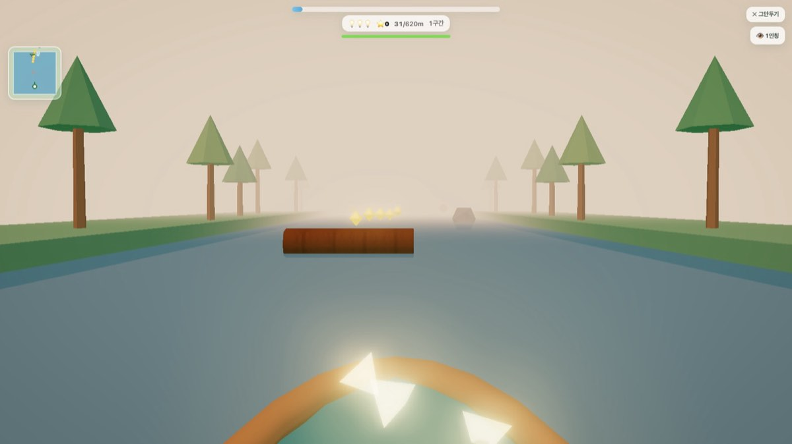

> 물의 가지가 살아나자 북쪽 나루터에 다시 배가 떴어요. 강물은 하루마다 새 물길을 내는데, 그날의 물길은 숲의 모두에게 똑같아요.

- **하는 법** · 배는 저절로 흘러가요. 좌우로 방향만 틀고, Space로 스퍼트. 바위와 통나무를 피하며 ⭐ 별조각을 모아요.
- **규칙** · 💡 램프 세 개가 목숨이에요. 약 60초, 하루 세 번.
- **보상** · 별조각으로 부두 창고에서 노 · 선체 · 등불을 강화해요. 하루 한 번 🧰 보물상자도 떠내려와요.

---

### 🌊 바다터 · 큰 물고기 줄다리기

> 등대 너머 바다에는 마을 호수엔 없는 큰 물고기가 살아요. 하루에 단 한 마리, ⚔️ 참치가 물길을 따라 들어와요.

- **하는 법** · 🔴 *버텨요…!* 땐 손을 떼고, 🟢 *당기세요!!* 땐 연타. 부두 끝 빨간 널판까지 끌려가면 놓쳐요.
- **어종** · 전갱이(낮) · 방어 · 개복치(밤) · 참치(하루 1마리).
- **보상** · 무게를 재고 놓아주면 물고기와 코인을 받아요. 가장 무거운 한 마리는 집 마당 연못에서 헤엄쳐요.

---

### 🌫️ 안개 낀 숲 · 정령 달래기

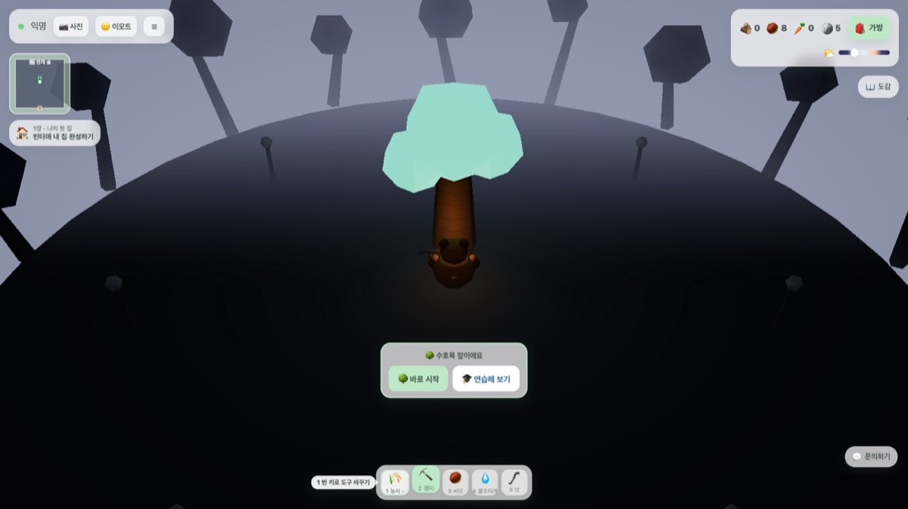

> 세계수의 심장을 감싼 안개 속에서 그림자 정령들이 길을 잃었어요. 이 숲에서는 싸우지 않아요. 노래로 달래요.

- **하는 법** · 정령이 다가오면 🏮 등불로 걸음을 늦추고, ♪ 표시가 가장 작아지는 순간 탭해요.
- **처음이라면** · 연습 모드부터 시작할 수 있어요.

---

### 🏔️ 설산 · 썰매와 산장 카페

<table>
  <tr>
    <td width="50%">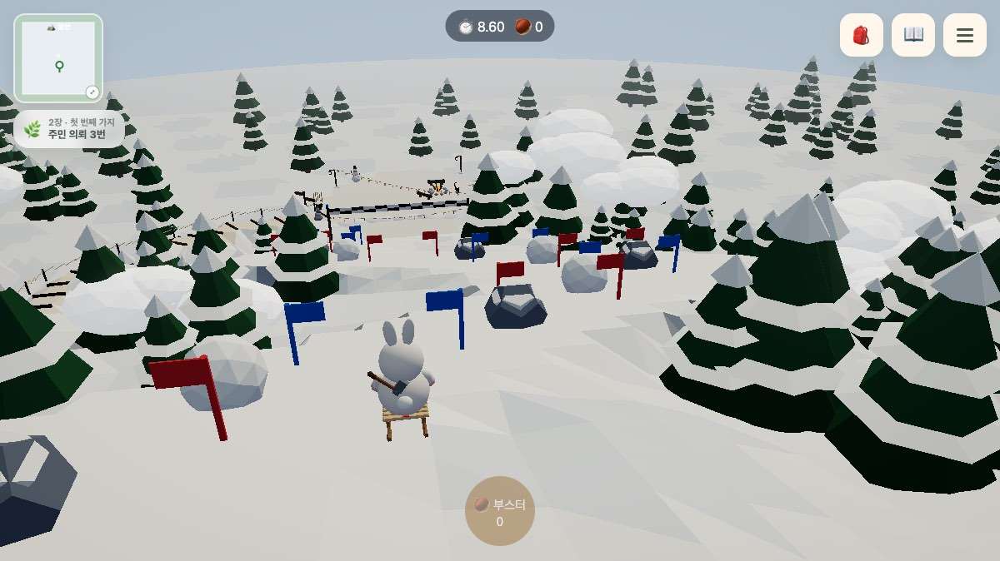</td>
    <td width="50%">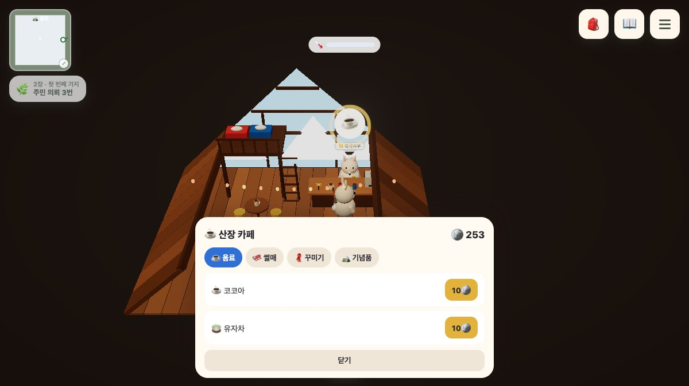</td>
  </tr>
</table>

> 마을 북서쪽, 눈 덮인 산. 능선을 따라 도토리를 줍고, 정상 산장에서 북극여우 바리스타의 코코아로 몸을 녹인 뒤, 썰매로 단숨에 내려와요.

- **하는 법** · 오르며 주운 🌰 도토리 수만큼 부스터를 쓸 수 있어요. ← → 로 방향, Space로 부스터. 깃발 12개 사이를 지나요.
- **추위** · 산에 오래 있으면 몸이 식어 걸음이 느려져요. 모닥불이나 따뜻한 차가 필요해요.
- **모으기** · 썰매마다 빠르기와 손맛이 달라요. 🏆 리더보드에서 오늘의 최고 기록을 겨뤄요.

---

### 🔭 천문대 · 별을 잇는 밤

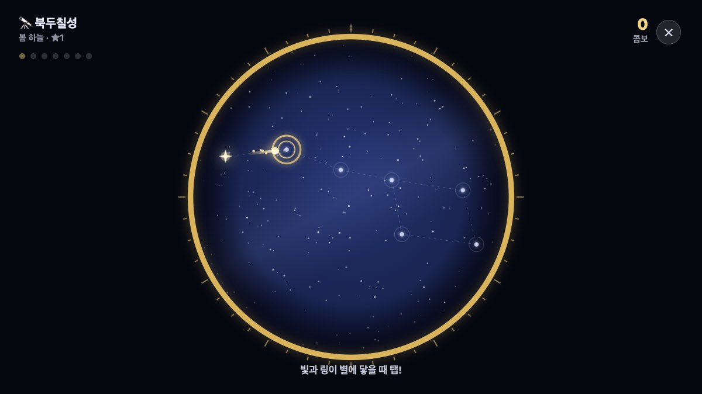

> 이야기 7장을 마치면 언덕 위 천문대의 문이 열려요. 흩어진 별을 하나씩 이어, 빈 별자리 수첩을 채워 가요.

- **하는 법** · 빛과 링이 별에 닿는 순간 탭하는 리듬 게임이에요.
- **별자리** · 북두칠성 → 카시오페이아 → 페가수스 → 사자자리 → 오리온 → 전갈자리. 앞의 별자리를 그려야 다음이 열려요.

---

### 🌙 꿈의 숲

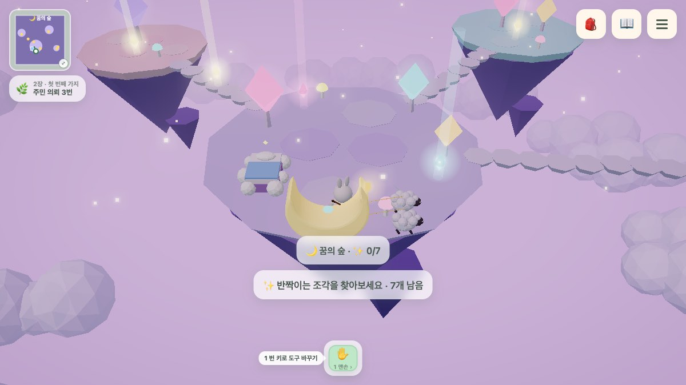

> 밤에 침대에 누워 "꿈꾸기"를 고르면, 초승달 마차가 구름 위 네 개의 섬으로 데려가요.

- **하는 법** · 구름 다리를 건너며 ✨ 꿈 조각을 주워요. 하루 일곱 개까지.
- **보상** · 꿈 조각으로 달 램프 · 수정 화분 · 별 모빌 · 구름 침대를 집에 들여요.

---

### 🪞 거울 마을

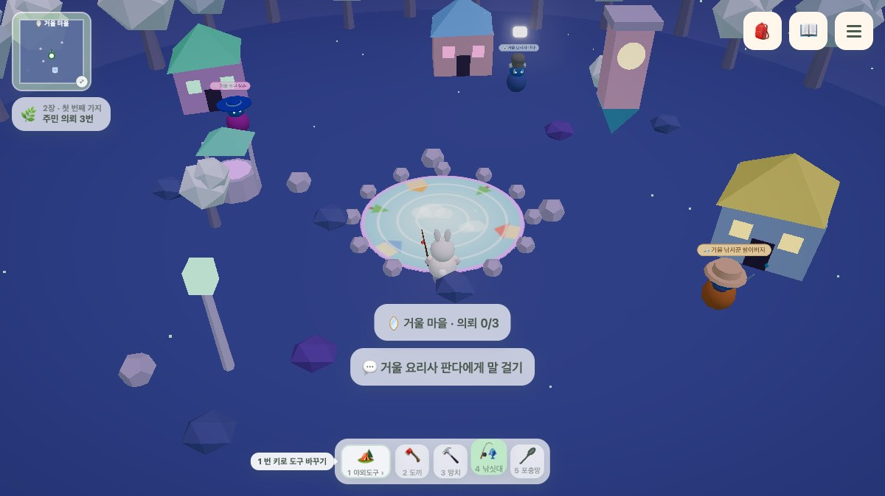

> 정류장에서 거울 마을행을 타면 모든 색이 반대인 마을에 닿아요. 그곳의 쌍둥이 주민들은 늘 무언가를 잃어버려요.

- **하는 법** · 농부 · 낚시꾼 · 요리사에게 단서를 듣고 잃어버린 물건을 찾아 돌려줘요. 막히면 💧 연못에 비춰 힌트를 봐요.
- **열리는 때** · 이야기 8장을 마치면, 낮에만. 밤엔 막차가 끊겨요.

---

### 🗿 조각 · 🍳 요리 · ☕ 카페

<table>
  <tr>
    <td width="33%">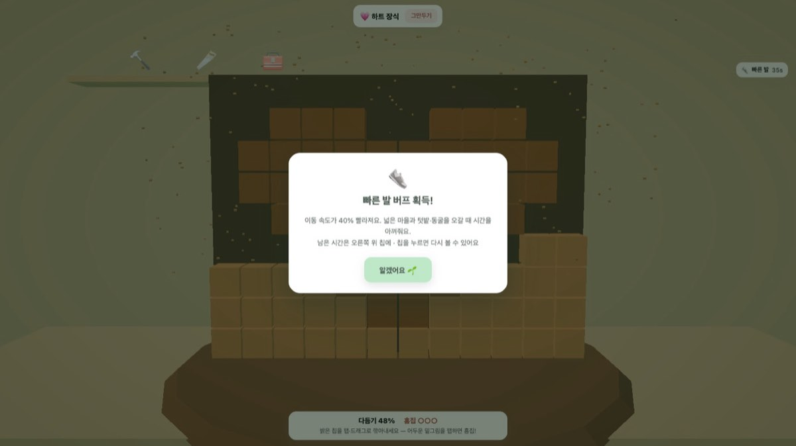</td>
    <td width="33%">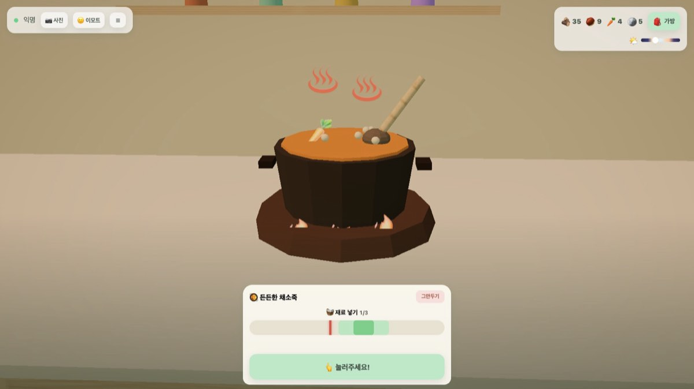</td>
    <td width="33%">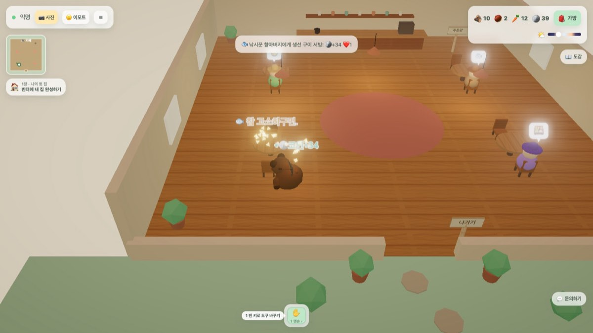</td>
  </tr>
  <tr>
    <td valign="top"><b>🗿 조각</b> 작업대에 매일 세 건의 주문이 들어와요. 밝은 칩을 깎아 내고 어두운 밑그림만 남겨요. 흠집 없이 깎을수록 값을 더 쳐 줘요.</td>
    <td valign="top"><b>🍳 자유주방</b> 레시피 11가지. 끓이기 · 썰기 · 굽기 · 간 맞추기 미니게임을 거치고, 잘 만든 요리일수록 효과가 오래가요.</td>
    <td valign="top"><b>☕ 카페</b> 손님 넷이 말풍선으로 주문해요. 찬장의 요리를 바로 내거나 그 자리에서 만들어 대접해요.</td>
  </tr>
</table>

---

### ✨ 그 밖의 즐길 거리

| | | |
|:--:|---|---|
| ⛏️ | **동굴 탐험** | 광맥을 캐다 보면 지하로 내려가는 길이 나와요. 스무 층 아래 수정 동굴까지, 떨어진 광석을 노리는 순한 방해꾼들을 피해 내려가요. |
| 🌟 | **반딧불이 계곡** | 밤에만 열리는 계곡. 반딧불이가 가장 밝게 빛나는 순간 포충망을 휘둘러요. |
| 🔥 | **밤사이 가공** | 화덕과 발효통에 재료를 걸고 짧은 미니게임을 하면, 자고 일어난 아침에 숯 · 밀가루 · 포도주가 완성돼요. |
| 🏮 | **빛 공방** | 반디 요정에게 바라는 빛을 한 줄로 적어 주문하면, 다음 날 나만의 오라가 완성돼요. |
| 🐾 | **밤손님** | 밤사이 마을에 남은 흔적. 따라가 보면 장난꾸러기 밤손님과 한판 승부가 기다려요. |
| 🏡 | **이웃 마을** | 다른 사람이 가꾼 마을에 구경을 가요. |

 

## 🍂 살아 있는 숲

<table>
  <tr>
    <td width="33%">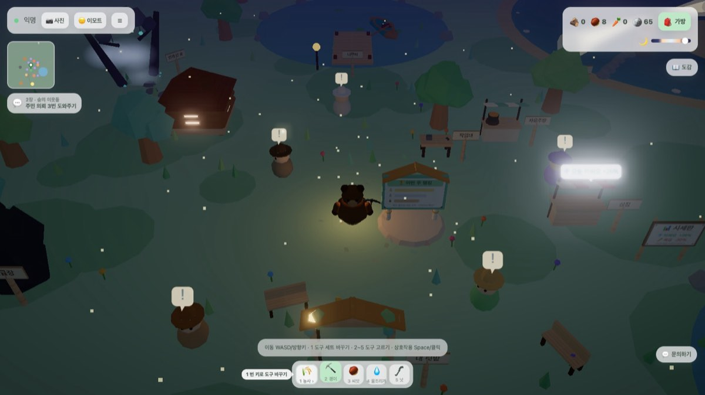 <b>🌗 낮과 밤</b> 하루는 8분. 밤이 오면 별과 반딧불이, 창문 불빛이 켜져요.</td>
    <td width="33%">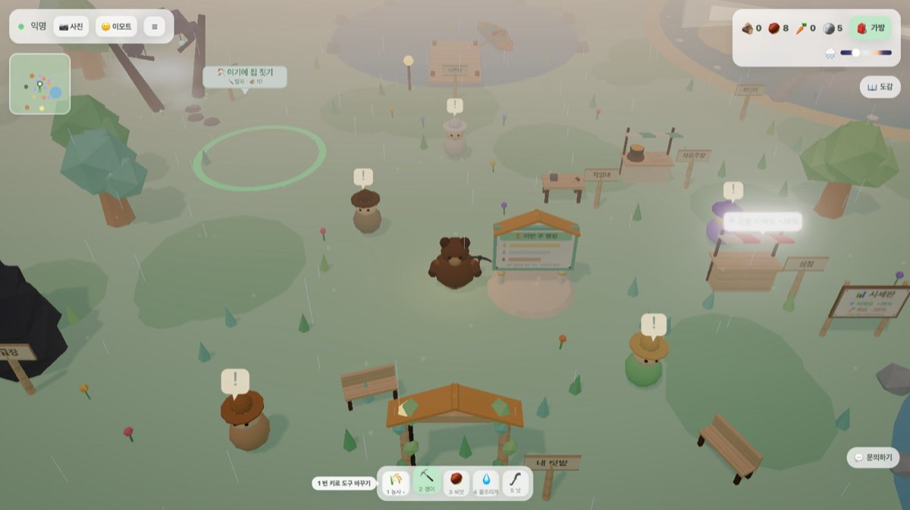 <b>🌦️ 날씨와 계절</b> 맑음 · 비 · 눈 · 안개. 숲의 모두가 같은 날씨를 겪고, 날씨마다 나오는 것이 달라요.</td>
    <td width="33%">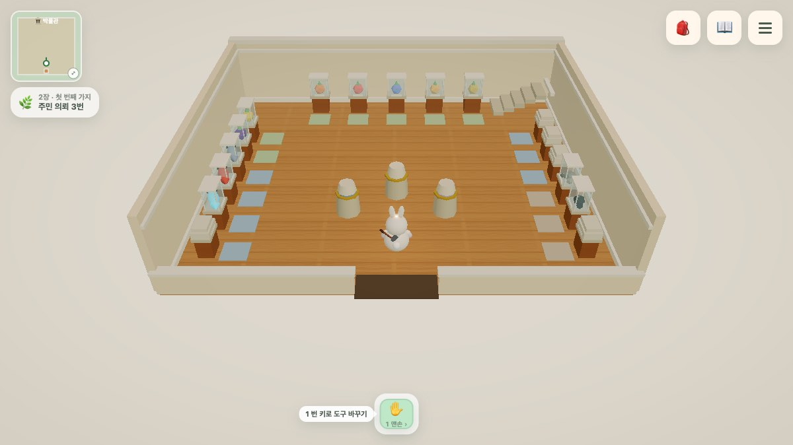 <b>🏛️ 도감과 박물관</b> 77종을 모으면 박물관 진열장이 한 칸씩 채워지고 위층이 열려요.</td>
  </tr>
</table>

- **꾸미기** · 모자 · 목도리 · 망토 · 펫 · 걷는 자국. 집 외관과 실내 가구, 마당 장식까지.
- **이야기** · 「나의 첫 집」부터 「이웃의 숲」까지 이어지는 장(章).
- **리더보드** · 뱃길 · 대어 · 주간 부자 · 광부왕 · 요리왕 · 퀘스트 · 썰매, 일곱 부문.
- **저장** · 30초마다 자동 저장. 로그인하면 어느 기기에서든 이어서 플레이해요.

 

## 🕹️ 조작

| | 🖥️ PC | 📱 스마트폰 |
|---|---|---|
| 이동 | W A S D · 방향키 | 왼쪽 아래 조이스틱 |
| 행동 (도구 · 대화 · 문 · 줍기) | Space | 오른쪽 아래 큰 버튼 |
| 도구 고르기 | 1 세트 넘기기 · 2~6 도구 | 도구 버튼을 탭해 펼치기 |
| 카메라 | 휠 확대 · Shift+휠 기울기 | 두 손가락 벌리기 · 밀기 |

도구는 상황에 맞게 저절로 바뀌기도 해요. 나무 옆에선 도끼, 호숫가에선 낚싯대, 집터에선 망치.

처음이라면 게임 안 ☰ 메뉴의 📖 초보자 안내서에서 첫 30분을 화면과 함께 따라가 보세요.

 

## 🧶 만든 방식

고요한 숲은 **Vanilla JS + Three.js** 로 만든 웹 게임입니다. 캐릭터 · 건물 · 나무 · 효과음까지 외부 모델이나 사운드 파일 없이 **모두 코드로 그리고 합성**했어요. 같은 코드가 웹 · 토스 · itch.io · iOS · Android 앱으로 나갑니다.

구조 · 로컬 실행 · 배포 · 데이터 분석 파이프라인은 [🛠️ 개발 문서](docs/DEVELOPMENT.md)에 정리돼 있어요.

 

   
  Made with 🌿 by <a href="https://github.com/UICHEOL-HWANG">Cheorish</a> · <a href="https://calmforest.cloud/privacy">개인정보처리방침</a>

